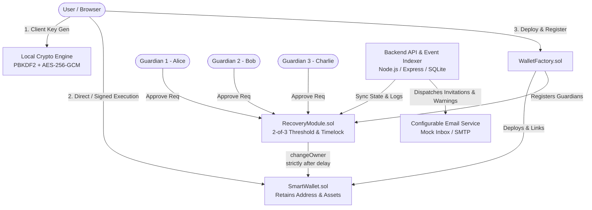

# RecoverID Shield — System Architecture Specification

**Tagline:** Lose Your Keys, Not Your Assets.

---

## 1. System Overview

RecoverID Shield is a production-grade, self-custodial smart contract wallet featuring an on-chain 2-of-3 social recovery system. The application solves the existential risk of Web3 key loss while preserving self-sovereignty, asset immutability, and zero reliance on centralized custodians or proprietary browser extensions.



---

## 2. Smart Contract Architecture

The on-chain layer is written in Solidity `0.8.24` and built with Foundry.

### 2.1 SmartWallet (`contracts/src/SmartWallet.sol`)
- **Ownership State:** Stores `address public owner` and `address public recoveryModule`.
- **Direct Execution:** Owners execute transactions natively via `execute(address target, uint256 value, bytes calldata data)`.
- **EIP-712 Signed Execution:** Supports gasless or relayer-assisted transactions signed off-chain via `executeSigned(...)` using domain separator and replay-protected nonces.
- **Convenience Transfer Methods:** Explicit functions `transferNative` and `transferERC20` with OpenZeppelin `SafeERC20`.
- **Ownership Replacement:**
  ```solidity
  function changeOwner(address newOwner) external onlyRecoveryModule {
      if (newOwner == address(0) || newOwner == address(this) || newOwner == owner) {
          revert InvalidOwnerAddress(newOwner);
      }
      address previousOwner = owner;
      owner = newOwner;
      emit OwnerChanged(previousOwner, newOwner);
  }
  ```
  `changeOwner` can **strictly** be invoked by the authorized `recoveryModule`. Direct calls from any other address—including the current owner—revert.
- **Asset Preservation:** During and after social recovery, the wallet contract address, ETH balance, and ERC-20 token balances remain untouched.

### 2.2 WalletFactory (`contracts/src/WalletFactory.sol`)
- Deploys new `SmartWallet` instances.
- Atomically links the wallet to the canonical `RecoveryModule`.
- Supports atomic initialization of 3 guardians in the same deployment transaction.
- Maintains global and user-specific wallet registries (`allWallets`, `userWallets`).

### 2.3 RecoveryModule (`contracts/src/RecoveryModule.sol`)
The social recovery engine implements an unambiguous on-chain state machine:

```
[None] 
  │
  │ initiateRecovery(wallet, proposedOwner)
  ▼
[Pending: Approval Phase]
  │
  ├───────────────────────────────────────────┐
  │ approveRecovery() (>= 2 distinct approvals)│ cancelRecovery() (Owner at ANY time)
  ▼                                           ▼
[Pending: Timelock Delay Phase]            [Canceled]
  │                                           ▲
  │ wait(executionDelay)                      │ cancelRecovery() (Owner)
  ▼                                           │
[Unlocked: Ready for Execution] ──────────────┘
  │
  │ executeRecovery()
  ▼
[Executed] ──> SmartWallet.changeOwner(proposedOwner)
```

#### Invariant Rules:
1. **Guardian Configuration:** Exactly 3 distinct guardian addresses required. Guardians cannot be zero address, the wallet itself, or the current wallet owner.
2. **Threshold Requirement:** Exactly 2 distinct approvals out of the 3 registered guardians are required (`THRESHOLD = 2`).
3. **Duplicate Protection:** Duplicate guardian approvals are rejected with `GuardianAlreadyApproved`.
4. **Timelock Delay:** Recovery requests enforce a configurable delay (default 24 hours, minimum 60 seconds). Early execution reverts with `DelayNotElapsed`.
5. **Legitimate Owner Protection:** The active wallet owner can cancel any pending recovery request at any time prior to execution.
6. **Request Expiration:** Requests expire after `unlockTime + EXPIRY_WINDOW` (7 days) to prevent stale request attacks.
7. **Concurrency:** Only 1 active pending recovery request can exist per wallet at a time.

---

## 3. Cryptographic Key Management & Storage

### 3.1 Local Key Derivation
Keys are generated purely on the client side using `ethers.Wallet.createRandom()`. Private keys and seed phrases are never transmitted across the network.

### 3.2 Authenticated Storage Scheme
Local keystores adhere to the following specification:
```json
{
  "version": 1,
  "id": "0x...",
  "address": "0x...",
  "crypto": {
    "cipher": "aes-256-gcm",
    "ciphertext": "0x...",
    "cipherparams": { "iv": "0x..." },
    "kdf": "pbkdf2",
    "kdfparams": {
      "iterations": 100000,
      "salt": "0x...",
      "digest": "sha256",
      "keyLength": 256
    },
    "mac": "0x..."
  }
}
```
- **KDF:** PBKDF2 with 100,000 rounds of SHA-256 and a 16-byte random salt.
- **Cipher:** AES-256-GCM authenticated encryption with a 12-byte random IV and 128-bit authentication tag.
- **Integrity MAC:** Keccak-256 hash over salt, IV, and ciphertext.

### 3.3 Domain-Separated Guardian Consent
Guardian invitations enforce domain-separated signatures to ensure a guardian explicitly consents with their key:
```
=== RECOVERID SHIELD GUARDIAN CONSENT ===
Smart Wallet: <wallet_address>
Guardian Address: <guardian_address>
Chain ID: <chain_id>
Action: REGISTER_GUARDIAN_CONSENT
```

---

## 4. Backend Service Architecture (`apps/api`)

The backend is built with Node.js, Express, TypeScript, and SQLite.

### Responsibilities:
1. **Guardian Invitation Tokens:** Issues cryptographically random single-use tokens, stores SHA-256 hashes in SQLite, and sends invitation emails.
2. **Consent Verification:** Verifies guardian ECDSA signatures against the domain-separated message before marking invitations as accepted.
3. **Notification Engine:** Dispatches simulated emails to a local SQLite inbox and logs them to terminal.
4. **Audit Trail:** Indexes on-chain and off-chain activities (`CREATED`, `GUARDIAN_INVITED`, `RECOVERY_INITIATED`, `RECOVERY_APPROVED`, `RECOVERY_EXECUTED`).
5. **Security Boundaries:**
   - The backend NEVER stores private keys, seed phrases, or master passwords.
   - The backend NEVER submits recovery approvals on behalf of guardians. The blockchain remains the sole source of truth.

---

## 5. Frontend Security Dashboard (`apps/web`)

Built with React 18, Vite, TypeScript, and Tailwind CSS using a sleek dark navy palette with emerald-green accents.

### Pages & Functional Views:
- **Landing Page:** Brand hero, interactive recovery breakdown, architecture pillars.
- **Create Wallet:** Local key generation, password derivation, keystore download, on-chain deployment.
- **Dashboard:** Real-time balances, ETH and token transfers, faucet funding, audit history, active recovery banner.
- **Guardian Management:** Inviting guardians, on-chain registration, timelock duration adjustments.
- **Guardian Acceptance Portal:** Cryptographic consent signature submission.
- **Recovery Portal:** Request initiation, guardian approval matrix, execution countdown.
- **Security & Backup:** Keystore decryption verification and threat model disclosures.
- **Local Dev Switcher:** One-click role switching between Owner, Guardians 1/2/3, and New Owner for instant demonstration.
